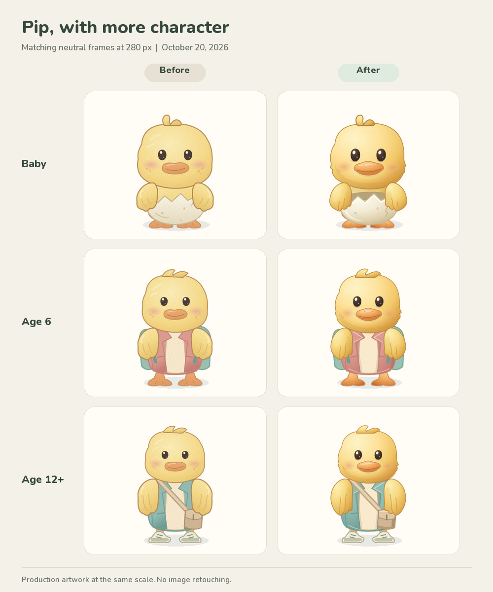
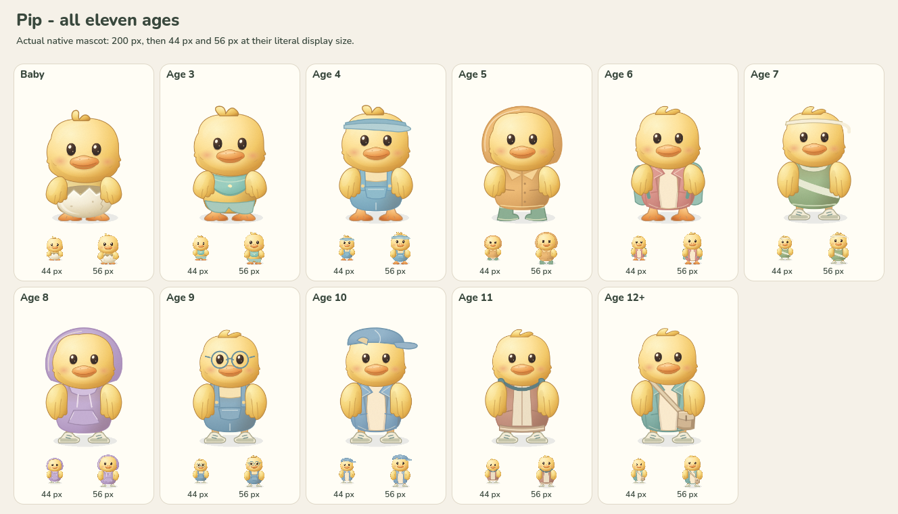
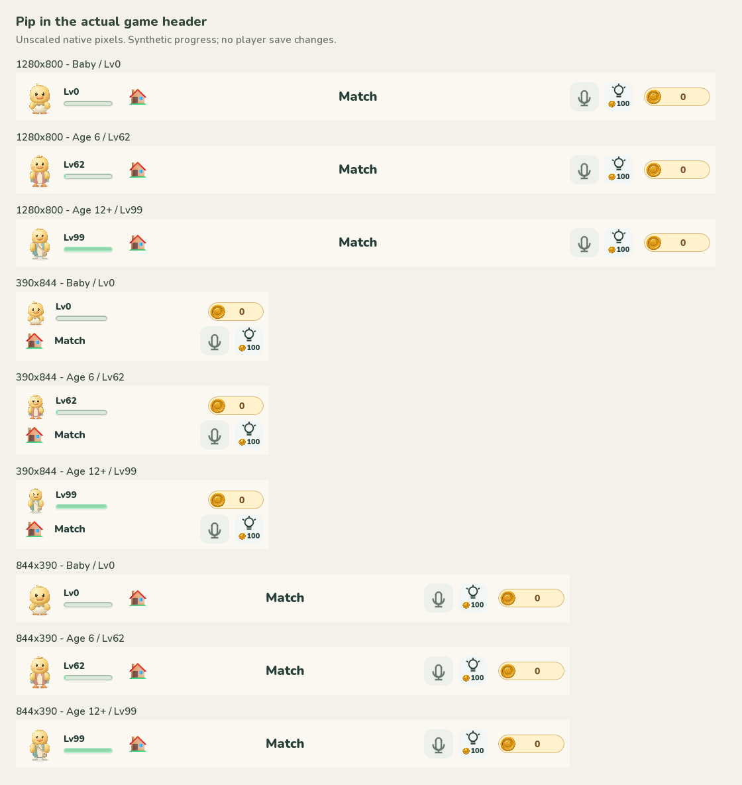

# Pip illustration refinement - October 20, 2026

**Follow-up correction:** the initial review below missed the detached-looking
wing shoulders, particularly Age 11 at rest and during torso squash. The later
[shoulder attachment revision](../pip-wing-2026-10-20/README.md) corrects the
artwork overlap, joint placement and torso-following transforms. These original
images remain unchanged as evidence of the earlier revision.

The existing project illustration now has softer directional face and wing
shading, a connected dimensional bill, a thick eggshell rim, and clearer garment
overlaps. All eleven ages, the base loading character and eight theme wardrobes
use the revision. Source and rights remain recorded in
[Pip growth artwork](../../assets/pip-growth.md).

Both columns use unretouched first cells of the production atlases at 280 px.
The before inputs were preserved before this change. The six-part rig, pivots,
age proportions, actions, durations and ten Ava recordings are unchanged.
The 55 PNG atlases total 7,396,786 bytes, down from 7,913,468 bytes (6.53%).

## Verification

- Regeneration and asset verification passed: 55 production/preview atlases
  match byte-for-byte, all 374 cell bounds fit, and all voice hashes match.
- Four native Pip suites passed: 8,799 assertions/checks, zero failures.
- Asset and wardrobe checks passed. A pre-existing import-count assertion was
  corrected to account explicitly for 20 reviewed career previews and the well
  cloud image, retaining provenance hashes and compression checks. The affected
  test passed on rerun; the other 30 checks passed in the original run.
- Native rendered stills cover every age at 44/56/200 px, ten expressions,
  speech/wave, result reactions, celebration, and every authored beat and
  reduced-motion pose of all 22 age actions. All 45 sheets were visually reviewed;
  no missing parts or clipped silhouettes were identified. The original claim
  that no detached wing roots were found was incorrect; see the follow-up above.
- All 36 loading/speech wardrobe poses were rasterized from the nine current
  SVG sheets and visually checked at 120 px. Accessories remain aligned and
  faces unobstructed; this is source-render evidence, not browser animation.
- The actual Main Match header was captured for Baby, Age 6 and Age 12/Lv99
  at 1280x800, 390x844 and 844x390. All 99 capture checks passed. Pip uses a
  44 px slot in portrait and 56 px in the two wider layouts, without badge overlap.
  Synthetic progress and fresh private save paths isolate player data.
- Chromium preview checks exercised all 22 actions, three repeated runs,
  age-change cancellation and reduced motion. Desktop, phone-size and landscape
  screenshots have no horizontal page overflow or page/resource errors.

Local detailed evidence and capture scripts are under
`build/pip-polish-20261020-r01/`. Run `npm run preview:pip` to interact with the
updated production artwork at http://127.0.0.1:41774/.

This review verifies native rendered poses and the browser asset preview. It
does not constitute physical-device testing, a new full web export/deployment,
continuous-animation timing approval, or a new audio assessment.
