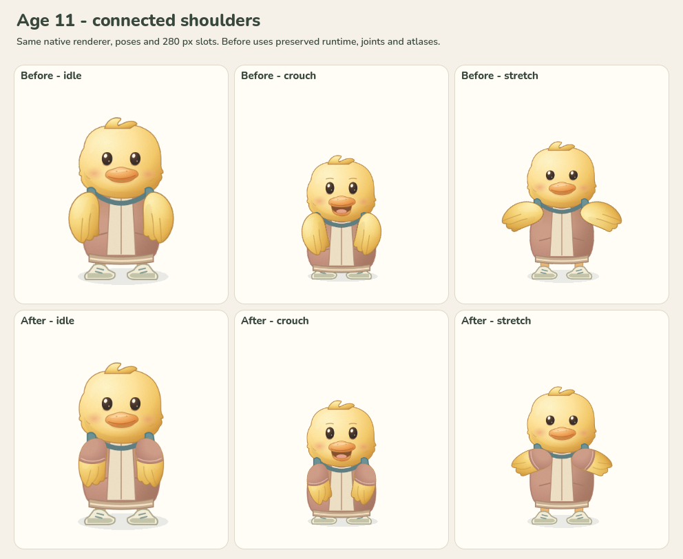
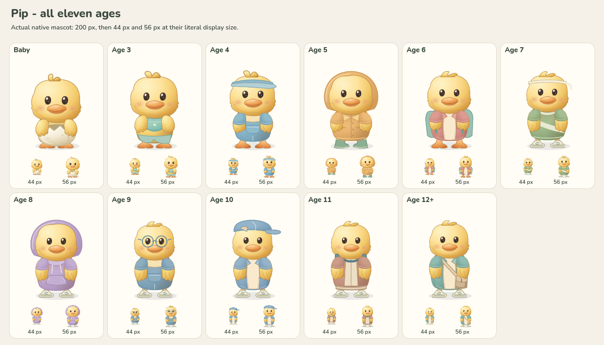
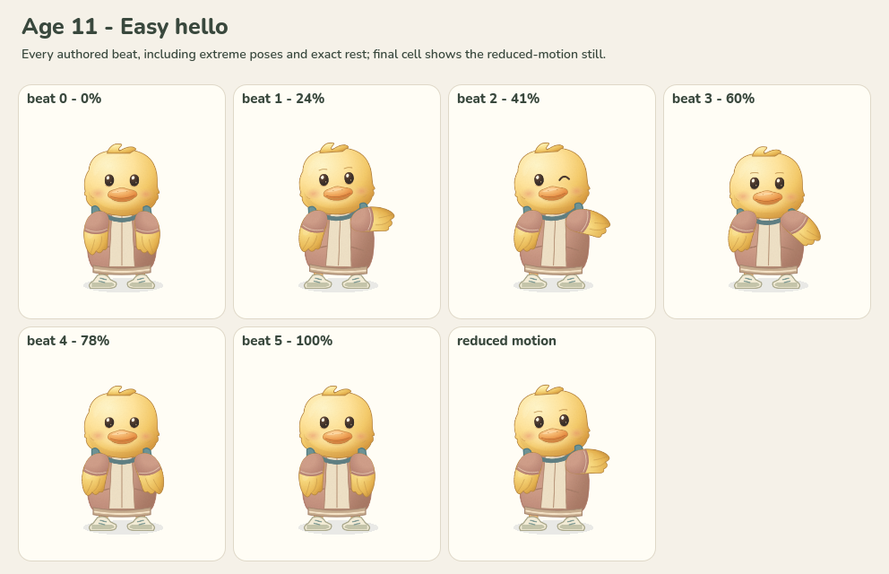
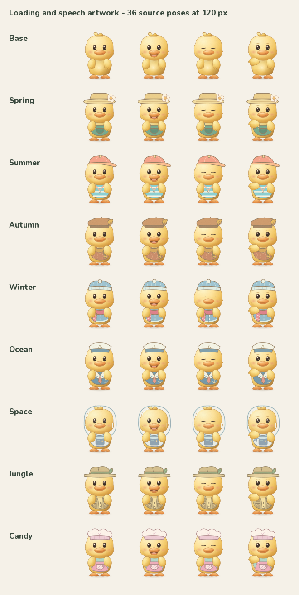

# Pip shoulder attachment correction - October 20, 2026

Pip's wings previously looked like separate paddles placed on the jacket. Their
joints were close to the torso outline, and independently transformed limbs did
not follow the shoulder when the body rotated or squashed. The initial
[illustration review](../pip-polish-2026-10-20/README.md) missed this problem.

Both rows use the same native renderer and 280 px character slots. The top row
renders the preserved previous mascot script, catalog joints and production
atlases. Idle uses reduced motion; crouch is the celebration's 0.18-second pose;
stretch is the shared gesture at 50%. No pixels were retouched. The earlier
illustration's gradients, bill, faces, clothing details and recordings remain.

## Change

The authored wing is narrower at the shoulder and overlaps the torso more
deeply. Ages 4 through 12 have a matching short sleeve with a curved cuff; Baby
and Age 3 retain bare wings. Shoulder pivots now sit within both opaque layers.
Native and preview motion map each shoulder through the torso transform, while
the feather retains its independently authored rotation and scale. The loading
shell applies the same rule to its dance, reactions and reduced-motion poses,
using the shared Age 3 artwork joints.

The existing project artwork remains the source. Its creator, license and
acquisition record are unchanged in [Pip growth artwork](../../assets/pip-growth.md).
This correction introduces no external artwork or replacement voice.

## Verification

- All 55 production atlases match their preview copies; all 374 atlas cells fit
  their transparent margins. All 11 expression-head atlases are byte-identical
  to the preserved version. The ten approved Ava recordings pass their existing
  hash checks, and the voice catalog is unchanged.
- Both source layers are opaque around all 22 shoulder joints. The smallest
  opaque radius is 7.18 art units in the body and 6.0 in the wing, providing
  continuous overlap when the wing rotates. See [asset checks](asset-verification.json).
- The new attachment regression passes 4,709 sampled poses and 117,759 checks.
  It covers all 11 ages, all 22 signature clips and their reduced stills, shared
  actions, celebration/reaction extremes, and combined rotation, squash and
  translation. It also confirms the preserved independent-root method exposes
  the original crouch defect. Five existing Pip suites pass another 9,539 checks.
- Native capture produced 45 sheets with 1,681 checks and no failures: all ages
  at 44/56/200 px, 132 expression/speech/wave cells, 132 feedback/celebration
  cells, and all 160 authored beats/reduced stills across 22 signature actions.
  The all-age overview, every signature sheet, all 11 feedback sheets and the
  matched comparison above were visually reviewed.
  Independent review of the overview and younger action extremes found no
  detached roots, clipping or face regressions.
- Chromium preview verification exercised all 11 ages and 22 actions over
  3,607 rendered frame samples. Maximum shoulder mismatch was
  0.000000856 SVG units, with no page, console or resource errors. Age 11 reduced
  idle and greeting were inspected at the actual preview size.
- All 36 loading/speech poses from the base and eight seasonal SVG sheets were
  rasterized and visually inspected at their literal 120 px cell size. The wave
  uses the new shoulder joint; accessories remain aligned and faces visible.
  These are source renders, not evidence of continuous browser animation.
- The loader's six CSS animation pivots match the shared Age 3 production
  catalog in a permanent source test. Wardrobe and web-export checks pass.
- The maintained loading shell passes the new attachment regression in Chromium
  and WebKit, with 1,972 interpolated dance/reaction samples per browser. Maximum
  shoulder drift is 0.3589435 art units during bonk, below the reviewed 0.5-unit
  tolerance and the 6-unit opaque shoulder overlap. Idle and reduced-motion
  anchors are exact within floating-point precision (at most 4.02e-14 units).
  Intended-display captures show no shoulder gap. This test uses the real shell
  and browser animation matrices with engine startup mocked; final evidence is
  in `build/pip-wing-20261020/loader-browser-stable/`.

Detailed captures, preserved preimages, manifests and scripts are in
`build/pip-wing-20261020/`. The compact native summary is
[verification.json](verification.json). This review uses frozen native poses
and Chromium/WebKit on the development machine; it does not claim physical-device or
audio testing. Full game export verification is recorded with the broader
[UI refinement](../ui-polish-2026-10-20/README.md).
