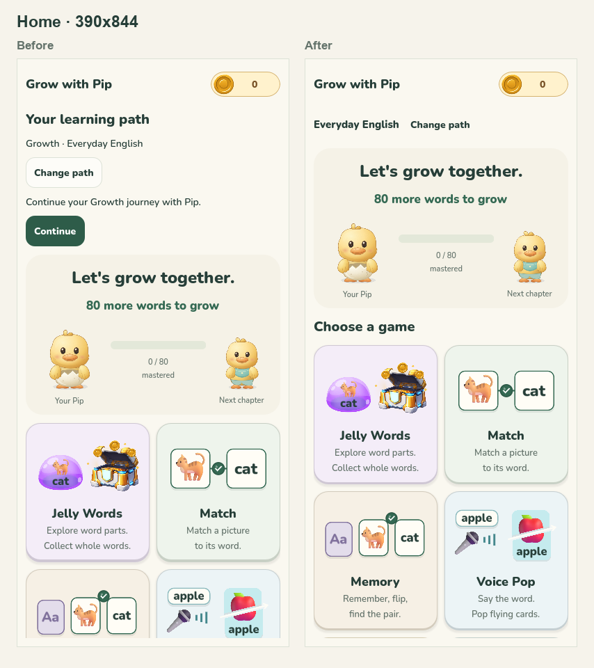
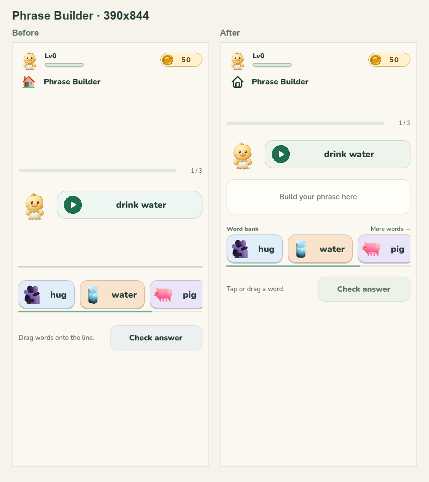
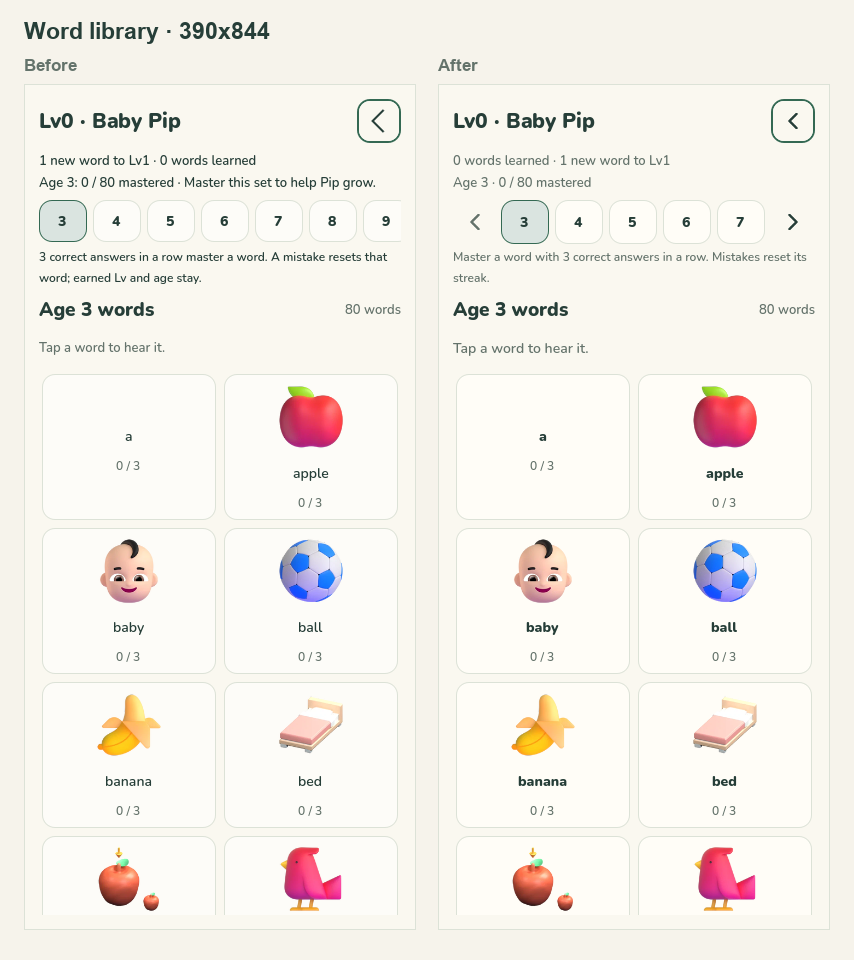
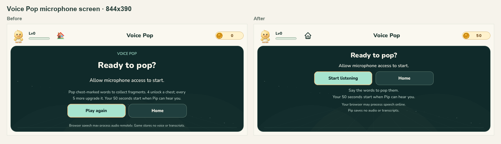
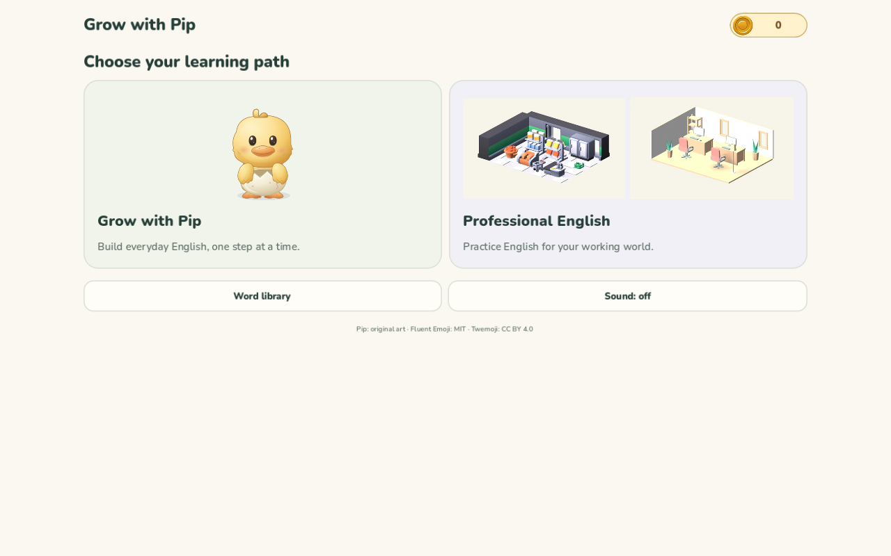
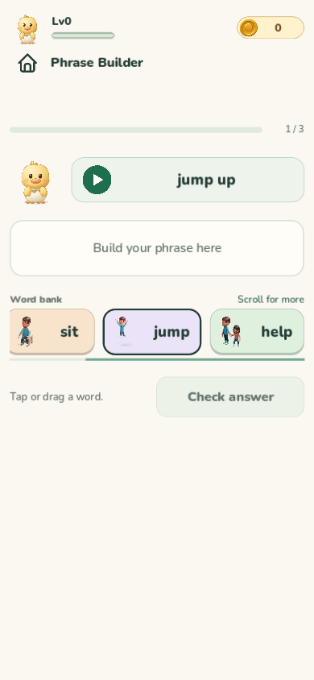
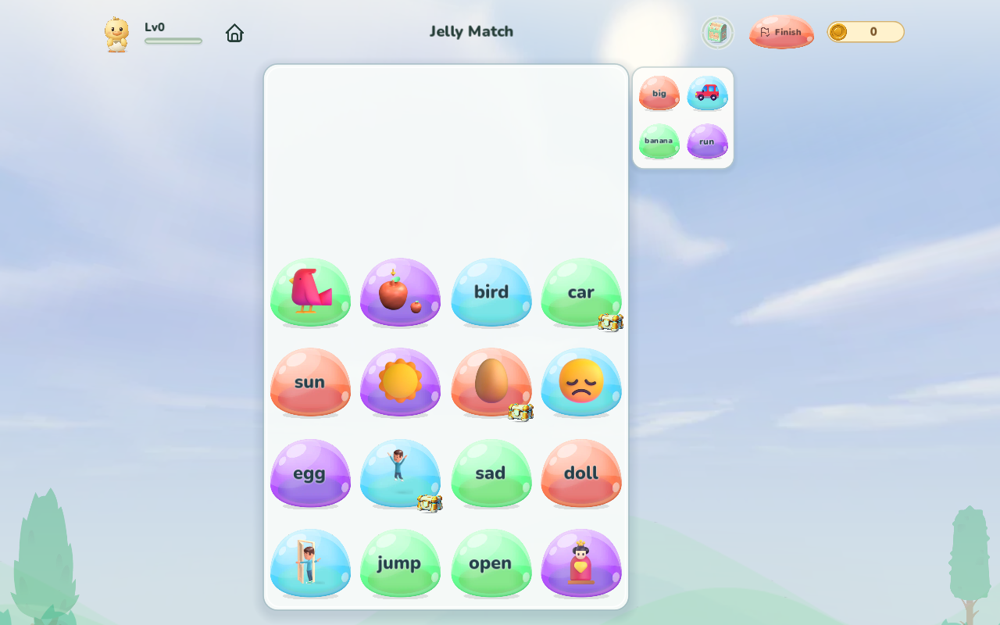

# Interface polish - October 20, 2026

**Native, final web export, and focused browser reviews are complete.**
This record covers the interface changes made after the task's script preimages
were saved in `build/ui-polish-20261020-r01/preimages/scripts/`. Earlier Pip
illustration, professional curriculum, media and deployment work are outside
this comparison.

## Changes under review

- Shared controls use consistent cream surfaces, borders, corner radii, focus
  styling and action typography. Navigation, microphone, hint and peek controls
  now use one acquired icon family, retaining the existing prices, counts and
  interaction states.
- Home gives learning paths larger illustrations and clearer headings, reduces
  repeated selection text, distinguishes available games from preparing modules,
  and simplifies loading and recovery copy while retaining readiness guards.
- Word libraries have stronger word/definition hierarchy, quieter metadata,
  consistent search styling and clearer pronunciation/progress grouping. The
  age selector gains explicit previous/next controls when its row overflows.
- Phrase Builder gives the answer area a visible surface and instruction,
  tightens spacing, and identifies the word bank and additional scrollable words.
  Its listening control shares the revised visual treatment. The final scroll
  hint uses "Scroll for more" to avoid unsupported arrow glyphs in the web font.
- Jelly Match's small next-piece preview fits labels using display-pixel font
  floors, accounting for canvas scaling so longer words remain complete.
- Voice Pop places its microphone action before secondary instructions and
  correctly says "Start listening" before a fresh round. Result and confirmation
  panels use coordinated typography, spacing and surfaces; Pip, chest and result
  instructions form a closer group.

## Capture methodology

| Evidence | Coverage | Current status |
| --- | --- | --- |
| Main before views | 21 states at 1280 x 800, 390 x 844 and 844 x 390: 63 PNGs | Existing capture inventory; not a pass count |
| Main after views | The same 63-view matrix using `capture-after.gd` | Captured and visually reviewed at all three sizes; inconsistent synthetic treasure examples excluded |
| Professional library | List and detail at 1280 x 800, 390 x 844 and 844 x 390, plus long-detail top/bottom at 320 x 568: 8 PNGs | Captured with zero fixture assertions failing; reviewed |

Main views use the actual `scenes/main.tscn`, seeded rounds, scripted navigation,
private isolated saves, reduced motion and muted audio. The matrix includes Home
paths/growth/footer, the growth word library, professional careers/modules/
selection/loading/recovery, all six game modes, microphone entry, results,
treasures and Finish confirmation. Capture scripts and per-image JSON reports
remain in `build/ui-polish-20261020-r01/`; selected reviewed comparisons are
retained below. The recorded before renderer is ANGLE with Microsoft Basic
Render Driver, not a physical mobile device.

The following states must be interpreted as fixtures:

- Loading and recovery are explicitly staged through the actual Home controls.
- After Match settlement reserves a deterministic chest, emits real card
  signals, completes feedback and advances the celebration clock. Assertions
  require the earned chest and visible final settlement before capture. The
  earlier landscape `match-result` image showed an unfinished board and is not
  valid before evidence for the result layout.
- Jelly settlement follows scripted Finish confirmation. Voice Pop uses
  simulated microphone readiness and manually advanced game time; its treasure
  view uses a synthetic two-chest summary. The first capture changed the count
  without its matching summary copy and is excluded from published examples.
- Professional library captures use the existing 50-term test fixture and its
  real `bank.webp` vocabulary illustration. They demonstrate interface layout,
  not released course content or reviewed professional media.

## Icon source and acquisition

Nine SVG controls were acquired on October 20, 2026 from **Tabler Icons v3.35.0**
by **Paweł Kuna**, under the **MIT License**. They are downloaded and integrated,
not source previews. Source-scale inspection covered 28 px icons inside 44 px
light/dark controls, including open/closed eyes and outline/filled microphones.
Only `currentColor` was replaced with white for theme tinting; paths and view
boxes are unchanged. The source art is static and has no animation clips.

Original URLs, source/integrated hashes and acquisition status are recorded in
[the control manifest](../../../assets/images/ui/controls/sources.json), with
[attribution](../../../assets/images/ui/ATTRIBUTION.md) and the retained
[MIT license](../../../assets/images/ui/LICENSE-Tabler.txt). The source contact
sheet is `build/ui-polish-20261020/control-icons-44px.png`. Native desktop,
portrait and landscape captures show consistent navigation and action icons.

## Verification status and limits

The eighteen native interface, library, phrase and reward suites passed with
38,755 checks/assertions and zero failures. The suite-level record is
`build/ui-polish-20261020-r01/native-final-results.json`. This covers compact
result bounds, gate scrolling, path readiness, age-rail navigation, reward flows
and the existing interaction regressions. The loading-copy correction passed
the 394-check selector suite and six focused loading/recovery recaptures.

The standalone library capture initially inherited a stale wrapped minimum
height on its first desktop layout. The harness now reapplies the host allocation
after layout and asserts viewport containment. All eight library views were
recaptured successfully; the desktop detail includes reachable pronunciation
and the complete practice summary. The production container was unchanged.

Asset checks passed 27/27, voice/scrollbar Node checks passed 104/104, and focused
Chromium/WebKit shell checks passed 10/10. The shell screenshots use a mocked
engine and microphone lifecycle, so they are not evidence of full-game browser
rendering. Native screenshots use Godot 4.7.2 with ANGLE and Microsoft Basic
Render Driver. No physical-device, speech recognition, sound quality,
continuous-animation timing or live-deployment verification is claimed.

The final Jelly preview correction passes 75 focused assertions covering the
actual desktop canvas scale, smaller preview widths, and word/size changes. It
does not change the board geometry or gameplay. The regression is registered in
the maintained Jelly test group.

The final r03 `npm run build:web` completed successfully on October 20, 2026 at
21:22 local time. Its startup download is 37.07 MB plus the selected age pack;
the export verified all required content and audio with zero pack failures.
The fresh build receipt is `build/web-build.json`; the full log is
`build/ui-polish-20261020-r01/build-web-final-r03-retry.log`. The initial r03
attempt timed out during the Godot template probe. An unchanged retry passed
the probe and the complete build; no validation was bypassed.

## Actual exported-game browser review

The r02 export was reviewed sequentially in Chromium at 1280 x 800 and 390 x 844,
and WebKit at 390 x 844. The review captured 51 states and 102 page/raw-canvas
PNGs using the actual engine and production assets. Only browser speech
recognition was simulated. It covered Home paths, professional career search and
readiness gates, the Growth word library, all six games, microphone pending,
denied and recovery states, and returning Home.

All 51 capture geometry checks passed: no document overflow, nonblank page and
canvas, 202 sampled menu/header targets at least 44 CSS pixels within floating-
point precision, and six speech-panel states with unclipped 12 px privacy copy.
All three contexts recorded zero page or console errors. Chromium reported
screenshot ReadPixels performance warnings; WebKit reported an extension
portability warning.

The original audit ended at an incorrect harness assertion in each context:
it expected Voice Pop to become `idle` after returning Home. The existing product
contract and maintained lifecycle tests require `paused`, preserving the active
round. The harness assertion was corrected without changing that lifecycle.
The original report is retained as recorded; it is not an all-green run.

Visual review found two production defects: the desktop Jelly preview clipped
`banana`, and the phone Phrase scroll hint showed unsupported arrow glyphs.
Both source fixes are included in the final rebuild. The focused supplement
passed in the same three browser contexts:

| Browser | Viewport | Captured states | Page/console errors | Home pause |
| --- | --- | ---: | ---: | --- |
| Chromium | 1280 x 800 | 4 | 0 | Passed |
| Chromium | 390 x 844 | 6 | 0 | Passed |
| WebKit | 390 x 844 | 6 | 0 | Passed |

All 16 final states and 32 page/raw-canvas PNGs passed their geometry, nonblank
rendering and sampled touch-target checks, with zero failed contexts. Visual
inspection confirms the full production word `banana` fits the same 34.8-unit
desktop preview slot that previously clipped it. Both phone browsers show the
Phrase hint correctly at the start, far end and returned start of the bank;
swiping does not select words or change the answer. The desktop bank fits and
correctly omits its scroll hint. Jelly Words' shared tiles also remain readable.

All three Home checks preserve the active Voice Pop round as `paused`. Remaining
time stays at 49, 49 and 50 seconds respectively during capture, and speech
recognition remains at one start per context. The corrected lifecycle assertion
passes without changing the product's existing pause behavior.

Full evidence is retained in
`build/ui-polish-20261020-r01/browser-after/` and
`build/ui-polish-20261020-r01/browser-after-supplement/`.
This review does not claim real-microphone, physical-device, sound-quality or
live-deployment verification.

## Reviewed layout comparisons

The pairs retain native screenshot pixels. They compare interface layout before
the final Phrase hint wording and follow-up Pip shoulder correction; its
character evidence is recorded in the
[Pip shoulder review](../pip-wing-2026-10-20/README.md).
Expected scroll-edge crops are preserved.

## Selected exported-game views

Home and microphone recovery are from r02; these surfaces are unchanged by
r03's two text corrections. The Phrase and Jelly views below are from final r03.

The reviewed [phone microphone recovery view](web-microphone-recovery-phone.png)
retains readable privacy copy and reachable recovery controls.
